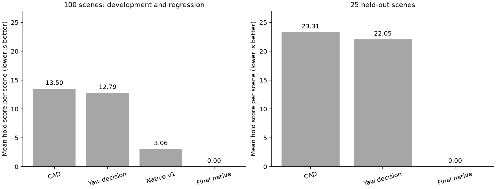
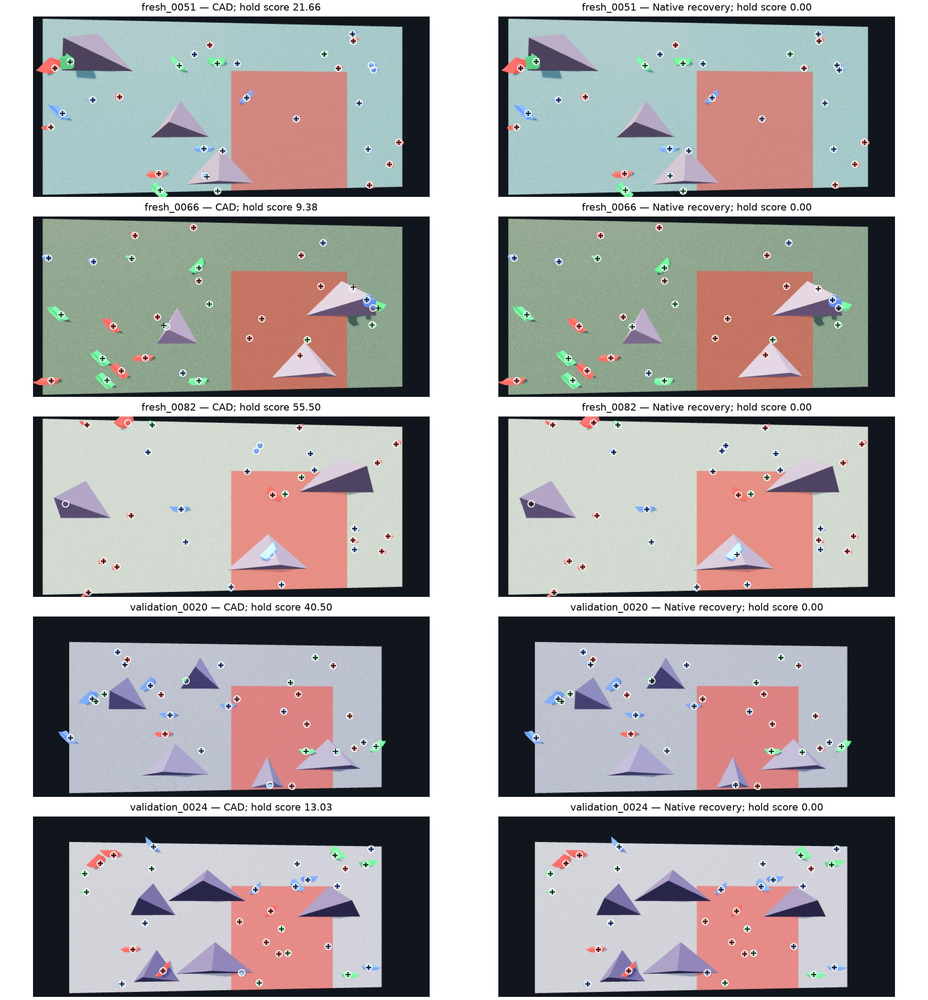

# Scored hold benchmark

This update targets the comparison in `jackybaltes/rcr-perception` at
[`b8c607e`](https://github.com/jackybaltes/rcr-perception/tree/b8c607e8dc2749ae2f512ce7265ef3018f32e9f5),
checked on 31 October 2026. It concerns hold and volume estimation. The released
comparison does not score the robot estimator.

**[Ours] Selected approach:** fit the four CAD meshes to both RGB views. For an
unedited scene from the pinned random generator, search its seed and verify the
regenerated geometry against both images. Otherwise, retain the image estimate
with a conservative yaw decision for wall-mounted Fingerpockets. Native recovery
is optional and requires an explicitly declared generator hold count.

## Results

The final native mode scores zero on all 165 tested native scenes, recovering
4,950 holds and 295 volumes at the source JSON precision. The 25-scene set was
held out during the final changes. Its last five cases have five volumes,
camera height 0.8 m and distance 1.15 m; calibration is supplied to the estimator.
The remaining cases use height 0.7 m and distance 1 m.

| Set | Status | Previous CAD: holds | Final: holds | Previous CAD: holds + volumes | Final: holds + volumes |
|---|---|---:|---:|---:|---:|
| Supplied 40 scenes | Regression | 565.22 | **0.00** | 595.26 | **0.00** |
| New random 100 scenes | Development/regression | 1,350.06 | **0.00** | 1,470.22 | **0.00** |
| Separate 25 scenes | Held-out validation | 582.68 | **0.00** | 642.79 | **0.00** |

These are summed scores; compare methods within a row. The held-out set has more
volumes per scene, so its average baseline error is higher. The final method
matches all 750 holds and 85 volumes in that set. No per-scene reference seed,
hold pose, volume geometry or answer cache enters inference.

The first native implementation was frozen before the 100-scene test. Its
failures then informed the verifier changes. The final result on those 100
scenes is therefore a regression result, not another held-out test.

| Method on the same 100 scenes | Hold score | With volumes | Accepted native scenes |
|---|---:|---:|---:|
| Previous CAD/support fit | 1,350.06 | 1,470.22 | — |
| CAD + halved wall Fingerpocket yaw | 1,279.29 | 1,399.45 | — |
| First native recovery, frozen before this set | 306.18 | 346.23 | 86/100 |
| Broader volume search and paint masks | 139.97 | 139.98 | 93/100 |
| Final verification | **0.00** | **0.00** | 100/100 |



The yaw decision reduces angular loss but cannot recover missed holds. In the
100-scene baseline, missing and extra holds contribute 940 points; angular
errors contribute 332.28. Recovering the complete source scene removes both
errors under the native-generator assumption.

On an RTX 5000 Ada with four fitting workers, the 25-scene CAD pass took 164.7 s
and native recovery took 40.9 s. The two stages total 205.6 s, excluding GPU queue
waits and scene generation. A separate single-image invocation, starting with
only RGB and calibration in its input folder, took 40.2 s and scored zero.
Batching amortises the full seed scan.

### What failed and what changed

The initial verifier reused the detector's bright-pixel mask inside each
projected hold. It rejected correctly aligned shaded green faces. Broadening
the mask everywhere then admitted coloured background patches. The final check
uses detector components globally and a broader colour test only inside each
rendered hold. It also handles blue highlights whose green and blue channels
both saturate. Regions with fewer than eight interior pixels do not supply a
per-hold rejection test.

Estimated volumes sometimes missed a volume or included a false one. Hard
filtering every generator candidate against those estimates excluded the correct
scene. A retry now tests all supported volume counts without that hard filter;
the two images still determine acceptance. Reordering output holds had no score
effect on the 40 supplied cases and was not retained as an optimisation.

The three existing Cube controls remain a separate test of the general image
path: 48 holds, including 12 Cube. Their hold score changes from 17.53 to 16.41
with the yaw decision. Native recovery is disabled for these controls.

Two edited-scene tests expose the native assumption. Removing a visible hold
rejects native recovery and uses CAD, scoring 11.00. Replacing a visible Microban
with a Cube **falsely accepts the original generator scene**, scoring 4.00 for
the wrong type. The image verifier is not a complete edit detector. A known
Cube or manually edited scene must use the general CAD path.

The earlier FoundationStereo, S2M2, FoundationPose and SAM-6D experiments remain
in the full branch. They were not rerun against this scorer. This update compares
the deployed four-mesh estimator, its score-based yaw decision and native
recovery on common inputs.



Five left-camera views, used for illustration after scoring. White rings show
reference backplate anchors; black crosses show predicted anchors. The overlays
show position and missing instances; rotation and type also contribute to the
displayed score. Some anchors lie behind volumes. Their recovery uses the
source-generation assumption. Full numeric results and prediction hashes are
in [`scored_benchmark.json`](scored_benchmark.json).

## What the score measures

**[Source]** Lower is better; zero means no scored discrepancy. The browser
matches holds by position within 100 mm, without using their type. It then scores
translation, wrapped Euler-component differences and type. Volumes are matched
separately by their two-dimensional centre. Volume scoring is disabled by default.
The final badge adds the active-scene and test-scene losses.

For a matched hold, its contribution to that final score is

\[
4(d/0.1)^2 + 2\sum_{a\in\{r,p,y\}}(\Delta a/(\pi/2))^2
+ 4\,\mathbf{1}[\text{wrong type}].
\]

Here, distances are in metres and angle differences wrap into ±π. A missing
object costs 10; an extra object also costs 10. A volume has only the position
term. The matcher uses ordered augmenting paths, so replacing it with a
minimum-distance assignment would change the evaluator.

| Error | Contribution to the final badge |
|---|---:|
| 10 mm translation | 0.04 |
| 45° error on one Euler axis | 0.5 |
| Wrong hold type | 4 |
| Missing hold or volume | 10 |
| Extra hold or volume | 10 |

Names, colours, dimensions, runtime and the seed field do not enter the score.
Colours remain useful observations during inference. The rotation term differs
from the earlier local SO(3) diagnostic and gives no symmetry allowance.

**Use the complete `prediction.json` for comparison.** The browser inherits the
active scene's volumes when a hold-only mapping is submitted. That can hide
volume-estimation errors. Our reported results compare complete independently
predicted scenes with volume scoring enabled. `score_scene.py` rejects a
hold-only input in this mode.

The Python scorer agrees with the unmodified JavaScript functions within
1.42×10⁻¹⁴ on the 40 supplied cases. Six browser UI comparisons on the latest source, including the
released test pair with volumes on and off, agree to the displayed six decimals.
The released test pair scores 20.000000 by default and 40.129600 with volumes.

The initial experiment used `0112f95`, whose UI enabled volume scoring. Upstream
changed the default during the run. The latest commit has identical scoring and
generator functions; the tables below show both scoring modes.

## How the selected method works

1. The existing RGB estimator finds coloured components, fits all four meshes
   in both cameras, estimates volumes and checks support and hull intersections.
2. With native recovery enabled, well-localised wall holds constrain the public
   sampler. A CUDA scan searches all nonzero 32-bit seeds. It uses position,
   colour and type from the image estimates, with three matching draws among the
   first twelve attempts. It does not read an input seed or reference geometry.
3. The pinned source regenerates candidate scenes with its actual mesh hulls,
   rejection rules and declared hold count. An initial pass tries the estimated
   volume count and one additional volume. Rejected cases retry every supported
   count from zero to ten, reusing the scanned seeds.
4. Pose consensus and two-view rendered masks select a candidate. Visible holds
   need colour support; the volume silhouette must agree; competing candidates
   must have distinct image losses. Shaded paint is checked within projected
   hold regions. Global masks retain the detector's background rejection.
5. If recovery is rejected or disabled, the output keeps the CAD estimate.
   Wall-mounted Fingerpocket yaw is halved when the resulting hull remains
   collision-free. This reduces squared angular loss under uncertainty. It is a
   decision for this score, not evidence of more accurate orientation recovery.

The generator is invoked through unchanged functions extracted from the pinned
source, with its source hash checked before execution. A host-JavaScript backend
reproduced all 483 candidates from the initial VM backend byte for byte and
generated 556 candidates in 30 seconds in a separate timing run. The initial VM
attempts were stopped after minutes of execution; these were not matched timing
trials.
Observation masks are cached within each scene during verification.

### Scope of native recovery

The public viewer supports Cube, Microban, Sidepull and Fingerpocket. Its current
random sampler chooses only the latter three. The 40 supplied scenes and native
random validation sets therefore contain no Cube holds. Use the general CAD path
for Cube scenes, manually edited scenes, unknown generators or photographs.

Native recovery assumes the pinned sampler, an unedited scene, the correct
declared hold count and supplied camera/wall calibration. Image checks reduce
incorrect acceptance; they cannot establish that every hidden object or manual
edit has been observed. A reconstructed occluded hold follows the generator
assumption. It is not a direct image measurement.

The code does not infer camera placement in this benchmark mode. Real-camera
localisation remains in the separate [recording workflow](REAL_IMAGES.md).
Robot estimation and physical cup mapping are unchanged by this update.

## Run it

The [main guide](README.md) covers the base installation. Native recovery also
requires Node.js 20+, npm and an NVIDIA CUDA compiler. All additional files stay
in the perception cache.

```bash
python3.12 scripts/perception/setup.py --benchmark
source .venv-perception/bin/activate

# Declare the actual generator count; 30 is used in the supplied archives.
python scripts/perception/benchmark_max.py \
  --stereo stereo.png --calibration rig.json --native-hold-count 30 \
  --out outputs/perception/scored

# For general four-type scenes, omit --native-hold-count.
python scripts/perception/benchmark_max.py \
  --stereo stereo.png --calibration rig.json \
  --out outputs/perception/image_fit

python scripts/perception/score_scene.py \
  --reference reference_scene.json \
  --prediction outputs/perception/scored/scene/prediction.json
# Add --volumes to include volume errors.
```

For the supplied archives:

```bash
python scripts/perception/prepare_samples.py \
  --samples samples --out data/local/scored_samples
python scripts/perception/benchmark_max.py \
  --dataset data/local/scored_samples --native-hold-count 30 \
  --out outputs/perception/scored_samples
```

The dataset manifest supplies case IDs only. Inference opens `stereo.png` and
`calibration.json`, then writes predictions, diagnostics and a summary. Optional
`--baseline PATH` reuses an existing CAD run; it must come from exactly the same
images and calibration. Leave it out for a complete independent run. Set
`RCR_PERCEPTION_HOME` consistently if using a custom cache. GPU work passes
through the existing load guard; busy external workloads are checked every
30 minutes.

### Reproduce the random evaluation scenes

[`scored_cases.json`](scored_cases.json) preserves the generation requests for
the 100-scene regression set and the separate 25-scene validation set. These are
evaluation inputs and are never loaded by `benchmark_max.py`.

The optional browser renderer needs Playwright in the same private Node cache:

```bash
export RCR_PERCEPTION_HOME="$HOME/.cache/rcr-perception"
npm install --prefix "$RCR_PERCEPTION_HOME/benchmark_js" \
  --ignore-scripts --no-audit --no-fund playwright@1.56.1
node "$RCR_PERCEPTION_HOME/benchmark_js/node_modules/playwright/cli.js" install chromium
node scripts/perception/render_benchmark.mjs \
  "$RCR_PERCEPTION_HOME/benchmark_runtime.json" \
  docs/perception/scored_cases.json data/local/validation25 validation25
python scripts/perception/benchmark_max.py \
  --dataset data/local/validation25 --native-hold-count 30 \
  --out outputs/perception/validation25
python scripts/perception/score_scene.py \
  --dataset data/local/validation25 --predictions outputs/perception/validation25 \
  --volumes --out outputs/perception/validation25/score.json
```

The renderer serves the pinned source locally and uses software WebGL. It writes
separate reference JSON, RGB and calibration files. Rendering or driver changes
can change raster pixels; the score and generation source remain pinned.
